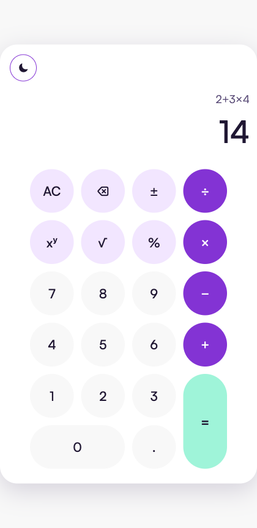
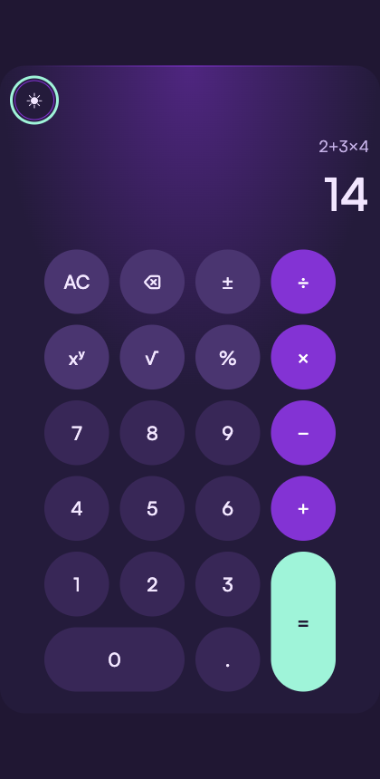

# Calculator

A full-stack calculator: a Go REST API that owns all the math, and a React + TypeScript keypad UI in Sezzle's brand. It was built as a take-home assessment ([brief](docs/brief.md)) using an AI-assisted, spec-first workflow described in [How this was built](#how-this-was-built).

<p align="center">
  
  
</p>

Highlights: `+ − × ÷ ^ √ % ±`, correct precedence, contextual percent (`200 + 10%` = `220`), repeat-`=`, full keyboard support, light/dark theme, structured errors, tested on both sides (Go stdlib tests, 99 Vitest tests), one-command Docker run.

## Quick start

```sh
docker compose up --build
```

Open http://localhost:8080 (UI and API share one origin; one multi-stage image).

## Local development

Requires Go 1.27 and Node 26. Install frontend dependencies once (needed for `make test` too):

```sh
(cd frontend && npm ci)
make dev-backend     # API on :8080  (cd backend && go run ./cmd/server)
make dev-frontend    # Vite dev server, proxies /api to :8080
```

## Tests and coverage

```sh
make test       # go test ./... and vitest
make coverage   # also writes reports to docs/coverage/
```

| Area | Statements | Branches | Functions | Lines | Report |
|---|---|---|---|---|---|
| Backend `internal/calc` (math) | 94.9% | n/a (Go reports statements) | n/a | n/a | [func list](docs/coverage/backend/coverage.txt), [HTML](docs/coverage/backend/coverage.html) |
| Backend `internal/api` (HTTP) | 97.0% | n/a | n/a | n/a | (same) |
| Backend total (all packages) | 83.1%* | n/a | n/a | n/a | (same) |
| Frontend | 97.87% | 94.23% | 100% | 99.3% | [HTML](docs/coverage/frontend/index.html) |

\*The backend total is over all packages, including `cmd/server/main.go` (process wiring, deliberately not unit-tested, 0%). The spec's target was at least 90% on `internal/calc`. Open the HTML reports locally; GitHub shows them as source.

## API

Full contract: [`openapi.yaml`](openapi.yaml). Real responses from `go run ./cmd/server`:

```sh
# Evaluate an expression (what the UI uses)
curl -X POST localhost:8080/api/v1/evaluate -d '{"expression":"2 + 3 * 4"}'
# {"result":14,"repeat":"* 4"}        (repeat = what a second "=" re-applies)

# A single operation
curl -X POST localhost:8080/api/v1/operations/divide -d '{"operands":[8,2]}'
# {"result":4}

# Error: division by zero -> 422
curl -X POST localhost:8080/api/v1/evaluate -d '{"expression":"1 / 0"}'
# {"error":{"code":"DIVISION_BY_ZERO","message":"Undefined"}}

# Error: malformed expression -> 400, with the 0-based character position
curl -X POST localhost:8080/api/v1/evaluate -d '{"expression":"2 + * 3"}'
# {"error":{"code":"INVALID_EXPRESSION","message":"Invalid input","position":4}}
```

Operations: `add subtract multiply divide power` (two operands), `sqrt percent` (one). `GET /healthz` returns `{"status":"ok"}`.

## Design decisions

Condensed from the spec's [decision log](docs/superpowers/specs/2026-11-16-calculator-design.md#8-decision-log).

| Decision | Chosen | Why |
|---|---|---|
| Where math lives | Backend: `/evaluate` + `/operations/{op}` | One language owns the math; single-op endpoints match the brief and fall out of the op table. |
| HTTP | chi | Small, net/http-compatible, middleware included. |
| Numbers | `float64`, rounded to 15 significant digits | `√` and fractional `^` need floats; rounding hides binary artifacts like a pocket calculator. |
| Errors | `{error:{code,message}}` | Machine-readable code for tests, display-ready message for the UI. |
| Wire format | ASCII expression string | Easy to curl and log; the backend owns tokenizing. |
| Parser | Hand-written recursive descent | Contextual `%` and precise error positions are not possible with a library; extends cleanly. |
| Repeated `=` | Backend returns `repeat` | Frontend never parses; API stays stateless. |
| Negatives | `±` sends `(-n)`; grammar has parens | Math rules stay intact and `±` does what users expect. |
| Input syntax | Decimals + e-notation, 256 char cap | Large results (`1e+21`) must round-trip through repeated `=`. |
| Layout | `cmd/` + `internal/calc` + `internal/api` | Pure math testable without HTTP, no extra ceremony. |
| Testing | stdlib only on the backend | No dependencies, idiomatic. |
| Deployment | One multi-stage image + compose wrapper | Same origin, no CORS, `docker compose up` stays the one-liner. |
| Visual identity | Sezzle palette, Satoshi, pill keys | User decision: it is a calculator for Sezzle, so it should feel like Sezzle. No logo or trademark assets used. |

**Float64 and rounding.** Exact decimals (`shopspring/decimal`, `big.Float`) would make `0.1 + 0.2` trivially right but cannot do `√` or fractional powers without falling back to floats anyway. So values are `float64`, rounded to 15 significant digits on output: `0.1 + 0.2` returns `0.3`. The cost is that results needing more than 15 digits are rounded, and integers above 2^53 lose exactness. `±Inf` becomes `OVERFLOW` and `NaN` becomes `INVALID_OPERATION`; neither is ever serialized.

**Why the math lives in Go.** The frontend only builds an expression string and displays what the API returns; its reducer never computes. Splitting arithmetic across two languages invites divergent precedence, rounding and error rules. Keeping it in one place means one test suite pins the behavior, and the same table backs both endpoints.

**Why Sezzle's brand.** The keypad format is the familiar phone calculator, but the identity (palette, Satoshi font, pill keys, purple operators, mint `=`) comes from Sezzle, built on our own design tokens with no UI library or Tailwind.

## Project structure

```
backend/
  cmd/server/          entrypoint: timeouts, graceful shutdown, -healthcheck
  internal/calc/       lexer -> recursive-descent parser -> op table + rounding, typed errors
  internal/api/        chi router, handlers, error -> HTTP mapping, SPA static serving
frontend/src/
  api/                 fetch client (non-JSON / network failure -> "Can't reach server")
  calculator/          pure reducer, expression token model, keyboard map, useCalculator hook
  components/
    atoms/             Key, DisplayLine, ThemeToggle
    molecules/         Display
    organisms/         Keypad, Calculator
    templates/         CenteredLayout
  pages/               CalculatorPage
  styles/              tokens.css (design tokens, light/dark), global.css
openapi.yaml           API contract
Dockerfile             multi-stage: frontend build + Go build -> one image
docker-compose.yml     one service wrapping it
Makefile               test, coverage, dev-backend, dev-frontend, docker
docs/                  brief, spec, plan, coverage reports, screenshots
```

## How this was built

The workflow is part of the deliverable. It was AI-assisted (Claude Code with the Superpowers skills), but spec-first and gated by review at every step:

1. **[Brief](docs/brief.md)**: the assessment as given.
2. **Brainstorming and grilling**: the design was explored interactively, then stress-tested question by question until every behavior (key rules, percent semantics, error copy, API shape) was decided or explicitly marked as a call.
3. **[Spec](docs/superpowers/specs/2026-11-16-calculator-design.md)**: goals, anti-goals, behavior, API, grammar, design system, and a decision log.
4. **[Plan](docs/superpowers/plans/2026-11-16-calculator.md)**: 15 small test-first tasks (14 build tasks plus a final review), each with files, steps and acceptance checks. A pre-flight scan checked every task's inputs against the previous task's outputs before any code was written.
5. **TDD implementation, one or more commits per task** (fix rounds add commits): each task was implemented by a fresh subagent (red, green, refactor), then gated by an independent reviewer who had not seen the implementer's reasoning. Nothing moved on until the review was clean. See `git log --oneline` for the Conventional Commit history.
6. **Final review** (task 15) of the whole branch.

What the per-task reviews caught (fixed before moving on):

| Task | Caught |
|---|---|
| 3 (parser) | Missing regression tests pinning `(-10)%` behavior. |
| 8 (reducer) | The repeat expression line showed raw `sqrt9` / `(-2)^2` instead of display symbols; also a bug where `⌫` and `%` did not clear an error state. |
| 11 (Calculator) | Global `Enter` handling hijacked the theme toggle (an a11y bug); a test that did not prove what it claimed, fixed and verified by mutation. |
| 12 (Docker) | `.dockerignore` patterns did not match nested paths, leaking host `node_modules` into the build context. |

Minor review findings that were not worth a fix round were logged and triaged in the final whole-branch review rather than dropped.

## Out of scope / next steps

Not in v1: scientific mode, calculation history, memory keys (`M+`/`MR`), locale-specific number formatting, and a bundled Sezzle logo (trademark).

Scientific mode is mostly groundwork already:

- The grammar already supports parentheses (the keypad only emits them for `±`), nesting, and unary/prefix functions (`sqrt` is one).
- The op table is the single place operations live: a new function (`sin`, `ln`, `log`, factorial) is one table entry plus a lexer keyword, and gets both `/evaluate` and `/operations/{op}` for free, with errors (`INVALID_OPERATION`, `OVERFLOW`) handled centrally.
- The frontend work is keys and display only; it never computes.
